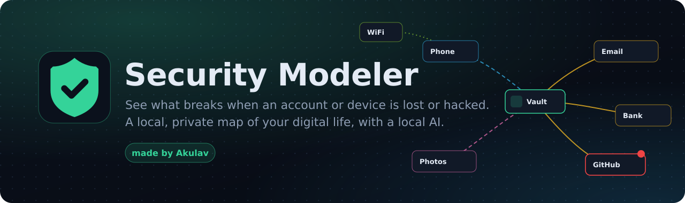
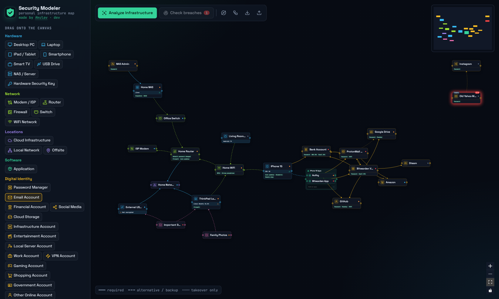
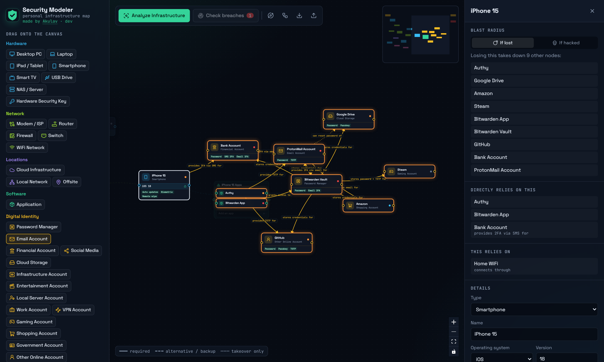
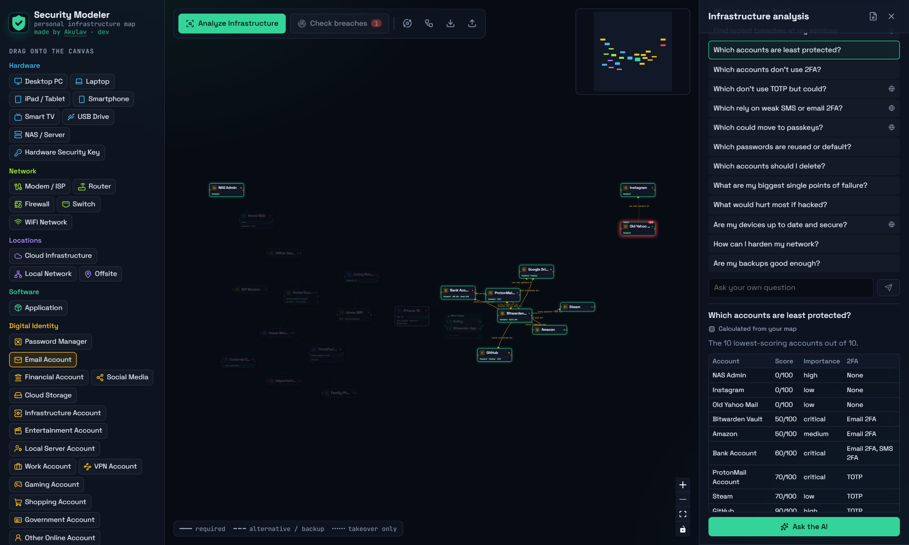
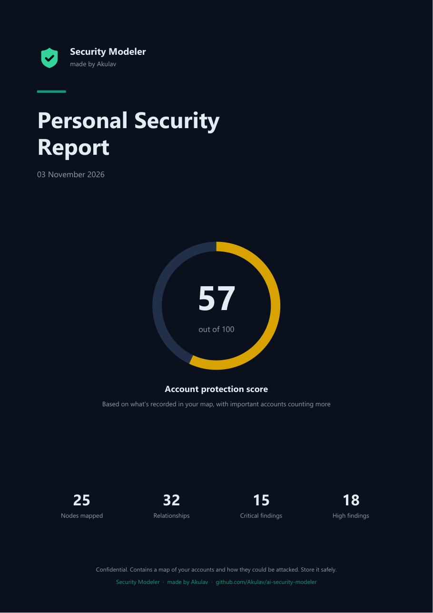
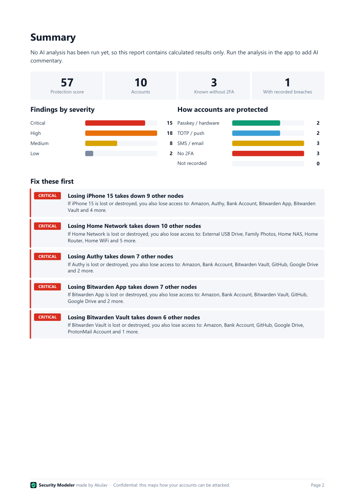

<p align="center">
  
</p>

<p align="center">
  <a href="https://github.com/Akulav/ai-security-modeler/releases/latest"></a>
  <a href="https://github.com/Akulav/ai-security-modeler/releases"></a>
  <a href="https://github.com/Akulav/ai-security-modeler/actions/workflows/release.yml"></a>
  
  <a href="LICENSE"></a>
</p>

<p align="center">
  <b>Map your accounts, devices, network and data as one interactive graph.<br>
  See exactly what breaks when one of them is lost or hacked, and fix the weak spots first.</b><br>
  <sub>Everything runs on your own machine, including the AI. Made by <a href="https://github.com/Akulav">Akulav</a>.</sub>
</p>

<p align="center">
  <a href="#-download"><b>Download</b></a> ·
  <a href="#-features"><b>Features</b></a> ·
  <a href="docs/USER_GUIDE.md"><b>User guide</b></a> ·
  <a href="#-privacy"><b>Privacy</b></a> ·
  <a href="#-license"><b>License</b></a>
</p>

<p align="center">
  
</p>

## ✦ Why Security Modeler

Most security advice is generic. Security Modeler works from **your** setup, and answers the questions that matter:

> 📱 If I lose my phone, which accounts am I locked out of?
> 🔐 If my password manager is hacked, does my 2FA still protect anything?
> 🧩 Which accounts have no 2FA, and which of those matter most?
> 🔁 Do my accounts depend on each other in a loop I couldn't recover from?

## ✦ Features

<table>
<tr>
<td width="50%" valign="top">

### 🗺️ Interactive map
Drag in 34 kinds of nodes, from phones and routers to bank accounts and backups, and connect them with 22 relationship types. Only connections that make sense are offered, and the star layout keeps even a password manager with 50 accounts readable.

</td>
<td width="50%" valign="top">

### 💥 Blast radius
Click any node to see what fails **if it's lost** and what's exposed **if it's hacked**. They're calculated separately, because a lost authenticator and a hacked one hurt you in different ways.

</td>
</tr>
<tr>
<td valign="top">

### 🧠 Local AI analysis
A local LLM explains the findings, researches your services on the web and answers your questions. It's set up automatically, never leaves your machine, and you can pick another model.

</td>
<td valign="top">

### ❓ Ready-made questions
14 questions, such as *Which don't use TOTP but could?* and *What would hurt most if hacked?* Every list is calculated instantly from your map, and the AI adds advice on top.

</td>
</tr>
<tr>
<td valign="top">

### 📄 Beautiful PDF report
A shareable report with a protection score, charts, every finding, every account and saved AI answers. Email and IP addresses are left out.

</td>
<td valign="top">

### 🚨 Breach checks
Optional HaveIBeenPwned lookups. Breached accounts glow red on the map and come with next steps.

</td>
</tr>
</table>

<p align="center">
  
  
</p>
<p align="center">
  
  
</p>
<p align="center"><sub>Screenshots use the built-in sample map. The breach shown is fictional.</sub></p>

## ⬇ Download

Get the latest build from the **[Releases page](https://github.com/Akulav/ai-security-modeler/releases/latest)**. Every release is built automatically from this repository, with a `.sha256` file to check each download against.

<details open>
<summary><b>🪟 Windows 10 or 11 (x64)</b></summary>

1. Download **`SecurityModeler.exe`**.
2. Run it. Nothing else needs installing: on first start it fetches its own Python and packages, which takes a minute or two.
3. The app opens in your browser. Click **Load sample graph** to explore.

It lives in the **system tray**. Click the icon to open the app; right-click it to unload the model, open the data or logs folder, or **Quit**, which frees all the RAM and VRAM the AI used.

</details>

<details open>
<summary><b>🐧 Linux (x86-64)</b></summary>

1. Download **`SecurityModeler-<version>-linux-x86_64.tar.gz`**.
2. Unpack it and install it for your user, with no `sudo` needed:
   ```bash
   tar -xzf SecurityModeler-*-linux-x86_64.tar.gz
   ```
   ```bash
   cd SecurityModeler-*-linux-x86_64 && ./install.sh
   ```
3. Open **Security Modeler** from your app menu, or run `~/.local/bin/SecurityModeler`.

**Needs** glibc 2.35 or newer (Ubuntu 22.04, Debian 12, Fedora 36 and later), plus GTK 3 and an AppIndicator library for the tray icon. Most desktops have them; on GNOME, the tray icon needs the *AppIndicator* extension. The AI can use NVIDIA and AMD graphics cards.

**On a server or without a desktop**, it runs in the terminal instead of the tray: `SecurityModeler --headless`. Open the address it prints in a browser, and press Ctrl+C to quit.

</details>

### Command line

| Option | What it does |
|---|---|
| `--background` | Starts without opening the browser, for example from a startup entry |
| `--headless` | Runs in the terminal, without a tray icon (automatic when there's no desktop) |
| `--quit` | Quits a running copy |
| `--version` | Prints the version |

## ⚙ First start and memory

The app sets up its AI in the background, with progress on the canvas and in the tray, and you can use the rest of the app meanwhile. Interrupted downloads resume, and later starts reuse the files.

| Download | Size |
|---|---|
| Python and the app's packages | about 100 MB |
| Portable Ollama, the local AI runtime | about 1.5 to 2.5 GB |
| The default model | about 16.3 GB |

Everything is saved in one data folder: `%LOCALAPPDATA%\SecurityModeler` on Windows, `~/.local/share/SecurityModeler` on Linux. Set `SECURITY_MODELER_HOME` to keep it somewhere else, such as a bigger drive.

The model leaves memory after a minute without use and loads again when needed; change this under **Free RAM and VRAM** in the analysis panel. It runs best with about 16 GB of video memory and 32 GB of RAM. On smaller machines, pick a smaller model, or skip the AI: calculated findings, question lists and the PDF all work without it.

> [!NOTE]
> The default model is "abliterated": its refusal behaviour has been removed. It may follow malicious instructions in web results more readily than a standard model, so check its advice before acting on it. You can choose another default under [Configuration](#-configuration).

## 🔒 Privacy

| Data | Where it goes |
|---|---|
| Your map, including email and IP addresses | Your data folder only, **unencrypted**. Use disk encryption such as BitLocker or LUKS. |
| Passwords | Nowhere. The app records only a password's *type*, never the password. |
| What the AI sees | Only the local runtime on your machine. Email addresses are cut to their domain, IP addresses are removed. |
| Web searches by the AI | DuckDuckGo. Searches containing your addresses are blocked, but they can name services you use. Untick **Let the model search the web** to prevent that. |
| Breach checks | An address goes to HaveIBeenPwned when you save it, only if you've added a key. |
| First-start downloads | GitHub, Python's package index and Hugging Face. None of your data is sent. |

The app listens only on `127.0.0.1` and has no login, so don't expose it to your network. More in the [security policy](SECURITY.md).

## 🛠 Configuration

Settings live in `.env` in the data folder, created on first start. Restart the app after changing it.

| Setting | Default | Purpose |
|---|---|---|
| `HIBP_API_KEY` | empty | [HaveIBeenPwned key](https://haveibeenpwned.com/API/Key) (paid). Breach checks stay off without it. |
| `LLM_AUTO_SETUP` | `true` | Set to `false` to use an Ollama you already run. |
| `OLLAMA_URL` | `http://127.0.0.1:11434` | That Ollama's address, when auto setup is off. |
| `OLLAMA_MODEL` | `hf.co/huihui-ai/Huihui-Qwen3.8-27B-abliterated-GGUF` | Model used until you pick another in the app. Needs tool support for web research. |
| `OLLAMA_TIMEOUT_SECONDS` | `1800` | How long to wait for one AI call. |
| `OLLAMA_NUM_CTX` | `16384` | Context size. Raise it for very large maps. |
| `LLM_IDLE_UNLOAD_SECONDS` | `60` | Seconds without use before the model leaves memory. `0` keeps it loaded. |

The launcher also reads `SECURITY_MODELER_HOME` for the data folder and `SECURITY_MODELER_PORT` for its preferred port (8000).

## 📚 Documentation

| | |
|---|---|
| 📖 [User guide](docs/USER_GUIDE.md) | Modelling your setup, and what every setting means |
| 🏗️ [Architecture](docs/ARCHITECTURE.md) | How it fits together, and the API |
| 🤝 [Contributing](CONTRIBUTING.md) | Building from source, tests and releases |
| 🛡️ [Security policy](SECURITY.md) | Threat model, and how to report a problem |

## 🧱 Built with

<p>
  
  
  
  
  
  
</p>

## 🗑 Uninstalling

**Windows:** quit from the tray, then delete `SecurityModeler.exe` and `%LOCALAPPDATA%\SecurityModeler`.
**Linux:** run `SecurityModeler --quit`, then delete `~/.local/bin/SecurityModeler`, `~/.local/share/applications/security-modeler.desktop`, the icon in `~/.local/share/icons/hicolor/256x256/apps/` and `~/.local/share/SecurityModeler`.

To free disk space but keep your map, delete only the `llm` folder inside the data folder. It downloads again on the next start unless you set `LLM_AUTO_SETUP=false`.

## 📜 License

**Source-available, not open source.** You may run the releases, read the code and change it privately, sharing changes privately with friends or family. You may not distribute modified versions, redistribute it, or make money from it. See [LICENSE](LICENSE) for the full terms. Dependencies and models keep their own licenses.

---

<p align="center">
  <br>
  <b>Security Modeler</b><br>
  <sub>Made with care by <a href="https://github.com/Akulav">Akulav</a> · © 2026 Akulav</sub>
</p>
